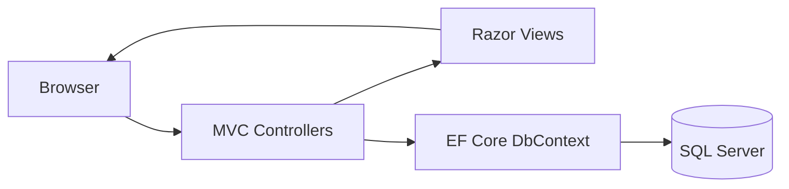

# Naano - Creator Marketplace MVP

A creator marketplace MVP built with **ASP.NET Core MVC (.NET 8)**, **Entity Framework Core**, and **SQL Server**. Brands can browse and filter creators, build campaigns, attach creators to them, and track campaign spend from a simple dashboard.

The project is inspired by the general user experience of creator marketplaces. All branding is original, all creators are fictional, and no proprietary assets are used.

---

## 1. Overview

Naano demonstrates the core workflow of a B2B creator marketplace:

1. Discover creators through search, filters, and sorting.
2. View a creator's profile.
3. Add creators to a new or existing campaign.
4. Review campaign details and performance on a dashboard.

The app seeds its own demo data on first run, so you can see a working marketplace without any manual database setup.

---

## 2. Features

- **Landing page** with a hero section, platform stats, a how-it-works section, and featured creators
- **Creator marketplace** with search, category and platform filters, and sorting
- **Creator profiles** with detailed information for each creator
- **Campaign management**: create campaigns with a creator multi-select, or attach a creator to an existing campaign
- **Campaign details** showing the attached creators
- **Dashboard** with summary cards, a spend-by-campaign bar chart, and a campaign table
- **Automatic demo data**: 18 fictional creators, 3 campaigns, campaign-creator links, and campaign metrics
- **Lightweight UI**: Bootstrap 5 and Bootstrap Icons loaded from a CDN, with CSS-gradient initials as avatars (no external image dependencies)

---

## 3. Tech Stack

| Area | Technology |
|------|------------|
| Framework | ASP.NET Core MVC (net8.0) |
| Language | C# |
| ORM | Entity Framework Core |
| Database | SQL Server (LocalDB by default) |
| Frontend | Razor views, Bootstrap 5, Bootstrap Icons |

---

## 4. Architecture

The app follows the standard MVC pattern. Controllers handle requests, Razor views render pages, and EF Core reads and writes data in SQL Server.



*Figure 1: Request flow through the MVC application.*

---

## 5. Pages and Routes

| Route | Description |
|-------|-------------|
| `/` | Landing page with hero, stats, how-it-works, and featured creators |
| `/Creators` | Marketplace with search, category/platform filters, and sorting |
| `/Creators/Details/{id}` | Creator profile |
| `/Campaigns/AddToCampaign?creatorId={id}` | Attach a creator to an existing or new campaign |
| `/Campaigns/Create` | New campaign form with creator multi-select |
| `/Campaigns/Details/{id}` | Campaign details and attached creators |
| `/Dashboard` | Summary cards, spend-by-campaign chart, and campaign table |

---

## 6. Getting Started

### 6.1 Prerequisites

- [.NET 8 SDK](https://dotnet.microsoft.com/download/dotnet/8.0)
- SQL Server or SQL Server LocalDB (included with Visual Studio)

### 6.2 Clone the Repository

```bash
git clone https://github.com/marslanakram/NaanoMVP.git
cd NaanoMVP
```

> The solution and project files may sit inside a subfolder of the repository. Move into the folder that contains `NaanoMVP.sln` before running the commands below.

### 6.3 Check the Connection String

Open `appsettings.json` and confirm the connection string. It defaults to LocalDB, so most Windows setups work without changes.

### 6.4 Run the Application

Using Visual Studio, open `NaanoMVP.sln` and press **F5**.

Or using the CLI:

```bash
dotnet restore
dotnet run --project NaanoMVP
```

On first run, the app calls `Database.EnsureCreated()` and seeds the demo data automatically. No manual migration step is needed to see data.

---

## 7. Database Setup

### 7.1 Default Mode (Demo)

The app uses `EnsureCreated()` for a zero-friction demo. The database and seed data are created automatically on first launch.

### 7.2 Optional: EF Core Migrations

If you want versioned migrations (for example, if a project requirement expects a `Migrations/` folder), run:

```bash
dotnet tool install --global dotnet-ef
dotnet ef migrations add InitialCreate --project NaanoMVP
dotnet ef database update --project NaanoMVP
```

Then, in `Program.cs`, replace:

```csharp
context.Database.EnsureCreated();
```

with:

```csharp
context.Database.Migrate();
```

---

## 8. Scope and Limitations

This is an MVP, so the following are intentionally out of scope:

- Authentication and user accounts
- Payments
- AI features
- Email notifications
- Admin panel

---

## 9. Roadmap

- User authentication and role-based access (brands, creators, admins)
- Creator onboarding and self-managed profiles
- Campaign proposals, messaging, and approvals
- Payments and invoicing
- Analytics with real campaign metrics
- Automated tests and CI/CD pipeline

---

## 10. Contributing

Contributions are welcome. Fork the repository, create a feature branch, commit your changes, and open a pull request.

---

## 11. Author

**Muhammad Arslan Akram** — [@marslanakram](https://github.com/marslanakram)
